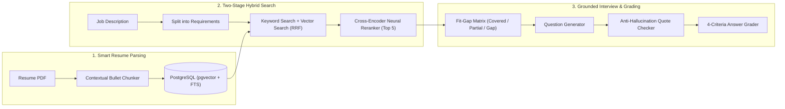

# Interview Forge — Evidence-Grounded AI Interview Copilot & RAG Evaluation Lab

Built by **Sam** · MIT Licensed

---

## 1. What Does This App Do? (In Plain Words)

When you are preparing for a software or AI/ML engineering interview, you have **your Resume** (a PDF) and **a Job Description** (what the company is looking for).

**Interview Forge** is an AI mock interviewer that:
1. **Compares your Resume against the Job Description** to show where you have strong proof (`Covered`), adjacent skills (`Partial`), or missing requirements (`Gap`).
2. **Generates tailored technical & behavioral interview questions** where **every single question is linked to an exact verbatim quote from your resume**—so the AI never makes up fake experience you don't have.
3. **Grades your practice answers** across 4 dimensions (*Relevance*, *Specificity*, *Structure*, and *Technical Clarity*) and gives specific feedback on how to improve.
4. **Includes a public AI Benchmark & Retrieval Lab (`/benchmarks`)** where you can inspect the search engine's accuracy metrics and test 8 different retrieval methods side by side in real time.

---

## 2. How the Project Started vs. Why Standard RAG Wasn't Enough

At the beginning, this project worked like most standard AI tutorials:
- It chopped resumes into **fixed 500-word blocks** (which mashed 2–3 different jobs together into one messy paragraph).
- It used **only one basic search method** (vector similarity) to match resume lines to the job description.
- It **trusted the LLM blindly** not to hallucinate fake resume quotes.
- It had **no evaluation dataset or metrics** to prove whether the retrieval pipeline or answer grader actually worked well.

To turn this into a production-grade AI/ML engineering system, we redesigned the entire pipeline and built a reproducible benchmark suite (**`ResumeJD-Bench v1`**) to measure every change.

---

## 3. How It Changed: The 5 Core AI/ML Upgrades

### Upgrade 1: Smarter Resume Splitting ("Contextual Bullet Chunking")
* **How It Was Before:** Cutting a 1-page resume every 500 words mixed unrelated jobs and skills into the same chunk. Only **8.1%** of the retrieved text was actually relevant to a given question (**92% was noise**).
* **How It Changed:** We built a structure-aware parser ([`chunking_service.py`](apps/api/app/services/chunking_service.py)) that detects resume sections (`Experience`, `Projects`, `Skills`, `Education`) and keeps each bullet point separate, automatically tagging it with its header like `[Experience | Senior ML Engineer at Stripe]`.
* **Measured Improvement:** Made the context fed into the LLM **6.5× cleaner** (Signal-to-Noise Ratio jumped from **8.1% → 52.7%**) and increased token-budget recall (`Recall@150tok`) from **17.2% → 77.6%**.

| Chunking Strategy | `Recall@150tok` | `Focus-nDCG@5` | Signal-to-Noise (`SNR@3`) | Why It Matters |
| :--- | :---: | :---: | :---: | :--- |
| **Legacy Fixed Window (`500w / 50o`)** | `17.2%` | `0.244` | `8.1%` | Giant chunks waste prompt tokens on unrelated jobs |
| **Smaller Fixed Window (`200w / 30o`)** | `41.1%` | `0.409` | `15.5%` | Still splits sentences across role boundaries |
| **Sentence Window (`3 sentences`)** | `58.9%` | `0.587` | `28.5%` | Cleaner, but bullets lose track of which company/role they belong to |
| **Contextual Bullet (`[Section \| Role]`)** | **`77.6%`** | **`0.727`** | **`52.7%`** | **Atomic bullets + role context = 6.5× cleaner context** |

---

### Upgrade 2: Combining Keyword Search + AI Vector Search + Neural Reranking
* **How It Was Before:** Pure vector search understands general meaning (e.g., *"built backend APIs"*), but frequently misses exact technical terms (`gRPC`, `pgvector`, `CUDA`, `HIPAA`) and falls for look-alike traps (e.g., confusing *"JavaScript"* with *"Java"*). Keyword search has the opposite problem: it finds exact words, but misses synonyms.
* **How It Changed:** We built an **8-strategy search engine** ([`retrieval_service.py`](apps/api/app/services/retrieval_service.py)) that runs **both** Keyword Search (PostgreSQL Full-Text Search + BM25) **and** AI Vector Search (`pgvector` + BGE embeddings) at the same time, merges their rankings (**Hybrid RRF**), and passes the top 15 results to a **Cross-Encoder Neural Reranker** (`BAAI/bge-reranker-base`) that reads the job requirement and resume bullet side-by-side to pick the best 5.
* **Measured Improvement:** Improved search ranking quality (`nDCG@5`) by **+18.3%** over standard vector search (`0.633 → 0.749`, statistically significant at $p = 0.0005$) and boosted top-5 evidence recall to **83.5%**.

| Retrieval Strategy | `nDCG@5` | `MRR@10` | `Recall@5` | Latency (`p50`) | Takeaway |
| :--- | :---: | :---: | :---: | :---: | :--- |
| **PostgreSQL Full-Text Search (`ts_rank_cd`)** | `0.648` | `0.692` | `72.3%` | `0.15 ms` | Fast exact keyword match; misses synonyms |
| **BM25 (`BM25Okapi`)** | `0.634` | `0.680` | `72.4%` | `0.16 ms` | Strong lexical baseline |
| **Dense Vector Search (`BGE-small-en-v1.5`)** | `0.633` | `0.678` | `72.1%` | `2.65 ms` | Original single-vector baseline |
| **Dense Vector Search (`BGE-base-en-v1.5`)** | `0.729` | `0.768` | `81.3%` | `7.34 ms` | Larger embedding model improves semantic match |
| **Hybrid RRF (Keyword + Vector Fusion)** | `0.694` | `0.733` | `78.5%` | `2.80 ms` | Best of both worlds without neural reranking overhead |
| **Hybrid RRF + MiniLM Cross-Encoder** | `0.735` | `0.784` | `82.6%` | `12.69 ms` | Fast 2-stage neural reranking |
| **Hybrid RRF + BGE Cross-Encoder Reranker** | **`0.749`** | **`0.788`** | **`83.5%`** | `44.96 ms` | **Best overall accuracy (+18.3% vs. Dense baseline)** |

---

### Upgrade 3: Pre-Interview "Fit vs. Gap" Detector
* **How It Was Before:** The app sent raw chunks to the LLM and asked for 6 random questions.
* **How It Changed:** Before generating questions, [`grounding_service.py`](apps/api/app/services/grounding_service.py) breaks the Job Description into individual requirements (`must_have` vs. `nice_to_have`) and scores each one against your resume as **Covered** (strong proof), **Partial** (adjacent skill), or **Gap** (missing skill).
* **Measured Improvement:** Achieves **0.858 AUROC** at detecting true skill gaps, allowing the interviewer to ask deep architecture questions on skills you *have* and targeted bridge questions on skills you *lack*.

---

### Upgrade 4: Anti-Hallucination Fact-Checker ("Citation Grounding Guardrail")
* **How It Was Before:** When asked to quote a candidate's resume, LLMs often exaggerate or invent quotes (e.g., claiming your resume says *"Led Kubernetes migration"* when you never wrote that).
* **How It Changed:** Every generated question must include an `evidence_anchor` (a quote from your resume). Our guardrail ([`grounding_service.py`](apps/api/app/services/grounding_service.py)) verifies that quote against your actual resume using fuzzy text alignment (`RapidFuzz`) and semantic similarity. If the LLM made up a quote, our system catches it (**100% detection rate / `1.000 F1`**) and automatically replaces it with the real verbatim sentence from your resume (lifting grounded citations from **66.7% → 100.0%**).

---

### Upgrade 5: Scientific Benchmark Dataset & Anti-Rambling Answer Grader
* **How It Was Before:** No dataset to test search accuracy, and no check on whether the AI answer grader simply gave higher scores to longer answers.
* **How It Changed:**
  - Created **`ResumeJD-Bench v1`** ([`apps/api/evals/datasets/v1/`](apps/api/evals/datasets/v1)): **12 realistic resumes (324 bullets)** and **160 job requirement queries** with human-style relevance grades (`0`, `1`, `2`).
  - Created the **Grader Calibration Benchmark** ([`answer_tiers.json`](apps/api/evals/datasets/grader/answer_tiers.json)): **64 graded interview answers** across 4 quality tiers, including adversarial **"length-confound" pairs** (concise 70-word expert answers with real metrics vs. 280-word buzzword-filled rambling answers).
  - **Measured Improvement:** Our 4-dimensional rubric grader achieved **91.7% pairwise accuracy** ($\rho = 0.830$) and **100% (7/7) accuracy** at beating the verbosity trap (whereas a word-count baseline scored **0%**).

---

## 4. How the Pipeline Works End-to-End



---

## 5. Quick Start (Run Locally)

### Prerequisites
- Python `3.12+`
- Node.js `20+` & npm
- PostgreSQL `16+` with `pgvector`

### 1. Start the Backend (`apps/api`)
```bash
cd apps/api
python3 -m venv venv
source venv/bin/activate
pip install -r requirements.txt

# Run database migrations (creates tables + pgvector HNSW + FTS GIN indexes)
alembic upgrade head

# Start FastAPI server on http://localhost:8000
uvicorn app.main:app --host 127.0.0.1 --port 8000 --reload
```

### 2. Start the Frontend (`apps/web`)
```bash
cd apps/web
npm install
npm run dev
```
Open in your browser:
- **Main App & Landing Page:** `http://localhost:3000`
- **Public AI Benchmark & Retrieval Lab:** `http://localhost:3000/benchmarks`

### 3. Re-run the Full Benchmark Suite & Tests
```bash
cd apps/api
venv/bin/python -m evals.run_benchmarks
venv/bin/pytest
```
For the full technical deep-dive (confidence intervals, permutation tests, and error analysis), see [`docs/AI-Pipelines/RAG-Evaluation-Report.md`](docs/AI-Pipelines/RAG-Evaluation-Report.md).
