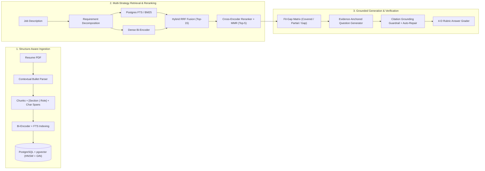

# Interview Forge — Evidence-Grounded AI Interview Copilot & RAG Evaluation Lab

**Interview Forge** is a full-stack AI/ML engineering system for evidence-grounded technical interview preparation and evaluation. Unlike generic LLM interview wrappers that dump whole documents into a prompt and hallucinate candidate credentials, Interview Forge pairs a **structure-aware contextual RAG pipeline** with **Two-Stage Hybrid Retrieval + Cross-Encoder Reranking**, **Requirement Fit-Gap Decomposition**, **Citation Grounding Guardrails**, and a reproducible **160-query IR & Answer Grader Evaluation Benchmark (`ResumeJD-Bench v1`)**.

Built by **Sam** · MIT Licensed.

---

## Key AI/ML Engineering Contributions

### 1. Structure-Aware Contextual Chunking (`bullet_contextual`)
Naive fixed-window chunking (`500` words, `50` overlap) blends unrelated job histories into a single noisy passage, causing severe **context dilution (`8.1%` Signal-to-Noise Ratio@3)**.
- Implemented a state-machine resume parser ([`chunking_service.py`](apps/api/app/services/chunking_service.py)) that detects section headers (`Experience`, `Projects`, `Skills`, `Education`), tracks active role/company headers, and prepends a `[Section | Role]` contextual prefix to each bullet before embedding.
- Records exact `[char_start, char_end]` character spans on the original document, enabling **overlap-adjusted `Focus-nDCG@k`** and **`Recall@B-tokens`** budget evaluation.
- **Empirical Impact:** Increases `Focus-nDCG@5` from **`0.244` → `0.727` (`+198%`)**, `Recall@150tok` from **`0.172` → `0.776` (`+351%`)**, and `SNR@3` from **`8.1%` → `52.7%` (`6.5×` cleaner LLM context)**.

### 2. Multi-Strategy Hybrid Retrieval & Neural Cross-Encoder Reranking
Implemented and benchmarked **8 retrieval architectures** in [`retrieval_service.py`](apps/api/app/services/retrieval_service.py) & [`embedding_service.py`](apps/api/app/services/embedding_service.py):
- **Lexical Baselines:** PostgreSQL Full-Text Search (`ts_rank_cd` with `GIN` index) and `BM25Okapi`.
- **Dense Bi-Encoders:** `BAAI/bge-small-en-v1.5` (384-d), `BAAI/bge-base-en-v1.5` (768-d), and OpenAI `text-embedding-3-small` with `pgvector` HNSW cosine indexing.
- **Hybrid Fusion:** Min-max normalized Convex Linear Fusion (`α = 0.6`) and Reciprocal Rank Fusion (`RRF, k = 20`).
- **Two-Stage Neural Reranking + MMR:** Stage-1 `Hybrid RRF` candidate pool (`top-15`) re-scored by a joint query-passage Cross-Encoder (`cross-encoder/ms-marco-MiniLM-L-6-v2` or `BAAI/bge-reranker-base`) with Maximal Marginal Relevance (`MMR`) deduplication.

| Strategy | `nDCG@5` (95% CI) | `MRR@10` | `Recall@3` | `Recall@5` | Latency (`p50`) | Paired Perm. $p$-value (vs. Dense) |
| :--- | :---: | :---: | :---: | :---: | :---: | :---: |
| **PostgreSQL FTS (`ts_rank_cd`)** | `0.648` `[0.587, 0.706]` | `0.692` | `64.4%` | `72.3%` | `0.15 ms` | $p = 0.6782$ |
| **BM25 (`BM25Okapi`)** | `0.634` `[0.573, 0.695]` | `0.680` | `62.2%` | `72.4%` | `0.16 ms` | $p = 0.9960$ |
| **Dense (`BGE-small-en-v1.5`)** | `0.633` `[0.577, 0.689]` | `0.678` | `60.5%` | `72.1%` | `2.65 ms` | Baseline |
| **Dense (`BGE-base-en-v1.5`)** | `0.729` `[0.677, 0.779]` | `0.768` | `71.6%` | `81.3%` | `7.34 ms` | $p = 0.0020$ |
| **Hybrid Linear (`α = 0.6`)** | `0.674` `[0.618, 0.727]` | `0.707` | `66.1%` | `76.7%` | `2.83 ms` | $p = 0.0565$ |
| **Hybrid RRF (`k = 20`)** | `0.694` `[0.639, 0.747]` | `0.733` | `66.1%` | `78.5%` | `2.80 ms` | $p = 0.0040$ |
| **Hybrid RRF + MiniLM-L6 Cross-Encoder** | `0.735` `[0.682, 0.785]` | `0.784` | `71.0%` | `82.6%` | `12.69 ms` | $p = 0.0005$ |
| **Hybrid RRF + BGE-Reranker-Base** | **`0.749`** `[0.695, 0.798]` | **`0.788`** | **`72.6%`** | **`83.5%`** | `44.96 ms` | **$p = 0.0005$ (`+18.3%`)** |

### 3. Requirement Fit-Gap Matrix & Hallucination Guardrail (`grounding_service.py`)
- **Pre-Generation Requirement Decomposition:** Extracts atomic job requirements (`must_have` vs. `nice_to_have`), retrieves top-3 candidate evidence chunks per requirement, and classifies each requirement into **`covered`**, **`partial`**, or **`gap`** (`Gap Detection AUROC = 0.858`).
- **Post-Generation Citation Verification & Auto-Repair:** Verifies every generated question's `evidence_anchor` against retrieved chunks using exact substring match, RapidFuzz partial ratio (`≥ 0.78`), lexical token overlap (`≥ 0.62`), and bi-encoder semantic entailment (`cos ≥ 0.64`). Automatically replaces fabricated anchors with the highest-entailment verbatim resume span (**`1.000 F1` hallucination detection**, lifting grounded anchor rate from **`66.7%` → `100.0%`**).

### 4. Multi-Dimensional Answer Grader Calibration (`answer_tiers.json`)
Evaluated on **16 interview scenarios × 4 rubric tiers (`64` graded answers)** including **7 adversarial length-confound pairs** (concise `60–90` word expert answers with concrete metrics vs. `220–300` word buzzword-heavy rambling answers):
- **Spearman $\rho = 0.830$**, **Kendall $\tau = 0.678$**, **Pairwise Tier Ranking Accuracy = `91.7%`**, **Quadratic Weighted Kappa = `0.727`**.
- **Length-Confound Immunity:** **`100.0% (7/7)`** accuracy on verbose-rambling vs. concise-expert pairs (compared to `0.0% (0/7)` for a naive word-count heuristic).

---

## System Architecture



---

## Quick Start

### Prerequisites
- Python `3.12+`
- Node.js `20+` & npm
- PostgreSQL `16+` with `pgvector` extension

### 1. Backend (`apps/api`)
```bash
cd apps/api
python3 -m venv venv
source venv/bin/activate
pip install -r requirements.txt

# Apply database migrations (includes pgvector HNSW + FTS GIN indexes)
alembic upgrade head

# Start FastAPI server on http://localhost:8000
uvicorn app.main:app --host 127.0.0.1 --port 8000 --reload
```

### 2. Frontend (`apps/web`)
```bash
cd apps/web
npm install
npm run dev
```
Open:
- **Landing Page:** `http://localhost:3000`
- **Public AI Benchmark & Retrieval Lab:** `http://localhost:3000/benchmarks`

### 3. Run the Full RAG & Grader Benchmark Suite
```bash
cd apps/api
venv/bin/python -m evals.run_benchmarks
venv/bin/pytest
```
Full methodology and ablation analysis: [`docs/AI-Pipelines/RAG-Evaluation-Report.md`](docs/AI-Pipelines/RAG-Evaluation-Report.md).
