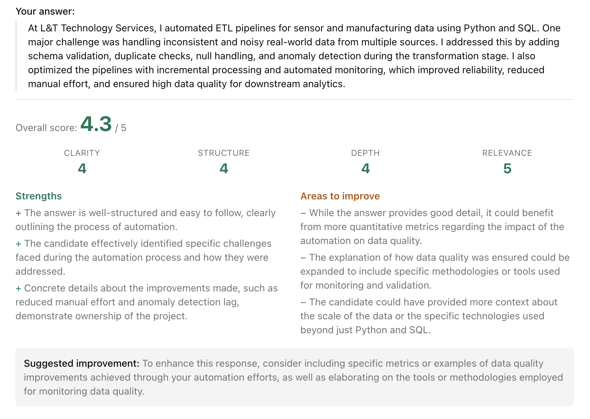
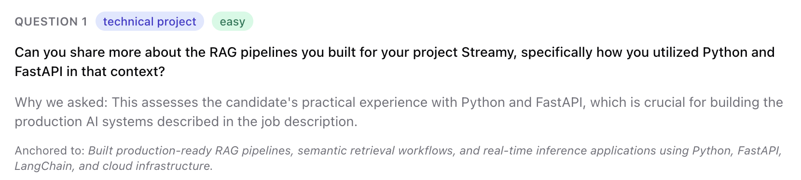
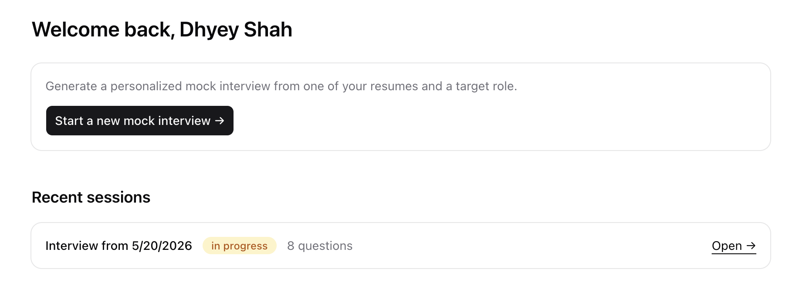

# Interview Copilot

> AI-powered mock interview platform with personalized RAG-grounded questions and calibrated rubric-based evaluation.

**[Try it live →](https://interview-copilot-lr3u.vercel.app)**




## What it does

Interview Copilot generates interview questions personalized to your resume and target job description, then grades your answers on a four-dimension rubric (clarity, structure, depth, relevance). Questions are grounded in verbatim phrases from your resume via RAG retrieval — no generic textbook prompts. Evaluations are calibrated against real senior-engineer expectations to avoid grade inflation.

Built solo in 16 days as a portfolio project demonstrating real AI engineering: RAG pipelines, structured outputs, prompt iteration with documented changelogs, and multi-step pipelines from upload to evaluation.

## Demo

**Personalized questions, grounded in your resume:**


**Dashboard with stats and recent sessions:**


## Features

- **Personalized question generation** — each question is grounded in a verbatim phrase from your resume (the "anchor"), focused on the target job description
- **Four-dimension evaluation rubric** — answers graded on clarity, structure, depth, and relevance with calibrated scoring; no grade inflation
- **Documented prompt iterations** — multiple versions of both pipelines with documented root cause and fix per iteration
- **Dashboard stats** — track sessions completed, total answers, average score, and your weakest dimension
- **Session lifecycle** — automatic status transitions from not_started → in_progress → completed
- **Full authentication** — JWT-based with token refresh and protected routes

## Tech stack

**Backend**
- FastAPI 0.115 (async) with Pydantic v2
- PostgreSQL 16 + pgvector for embeddings
- SQLAlchemy 2.0 async + Alembic
- OpenAI structured outputs (gpt-4o-mini for question generation, gpt-4o for evaluation)

**Frontend**
- Next.js 16 with React 19 (App Router, server components)
- TypeScript, Tailwind CSS v3.4, shadcn/ui
- react-hook-form + zod for validation

**Infrastructure**
- Docker Compose for local development
- Railway for production database + API hosting
- Vercel for frontend hosting

## Architecture

┌──────────────┐       ┌─────────────┐       ┌─────────────┐
│  Next.js 16  │ ◄───► │  FastAPI    │ ◄───► │ PostgreSQL  │
│  (Vercel)    │       │  (Railway)  │       │ + pgvector  │
└──────────────┘       └─────────────┘       └─────────────┘
│
├─► OpenAI gpt-4o-mini (generation)
├─► OpenAI gpt-4o (evaluation)
└─► OpenAI text-embedding-3-small (RAG)

Detailed system design: [docs/SystemDesign/](docs/SystemDesign/)

## AI engineering deep-dive

This project was built with an emphasis on documented AI engineering practice. Two prompt pipelines went through multiple iterations to address specific failure modes:

**Question generation pipeline** — [CHANGELOG](docs/AI-Pipelines/prompts/question_gen/CHANGELOG.md)
- v1 → v2: fixed anchor leakage from job description into resume; added required easy warm-up question

**Evaluation rubric pipeline** — [CHANGELOG](docs/AI-Pipelines/prompts/evaluation/CHANGELOG.md)
- v1 → v2: fixed grade-inflation (5/5/5/5 with empty weaknesses arrays) via stronger calibration language + Pydantic min_length constraints + ValidationError in tenacity retry tuple
- v2 → v3: fixed edge case for non-answers (no real strengths to credit)
- v3 → v4: fixed model parking on "decent answer" cluster (always 4/4/4/5) with explicit score distribution + score variance rule
- v4 → v5: removed length bias from scoring, upgraded to gpt-4o, added few-shot anchor example

Each iteration documents the failure mode observed, the root cause hypothesis, the fix applied, and the result verified.

## Decision logs

Major architectural decisions are documented: [docs/DecisionLogs/](docs/DecisionLogs/)

Highlights:
- Stack selection (FastAPI + Next.js + pgvector)
- Next.js 16 upgrade for May 2026 CVE patches
- Client-side auth guard with documented v1.1 migration path to httpOnly cookies
- bcrypt version pinning for passlib compatibility

## Local setup

Prerequisites: Docker, Node.js 20+, OpenAI API key

```bash
git clone https://github.com/DhyeyShah2805/interview-copilot.git
cd interview-copilot

# Set up environment — OpenAI key required
cp .env.example .env
# Edit .env and set OPENAI_API_KEY

# Bring up Postgres + API
docker compose up -d

# Frontend dev server (separate terminal)
cd apps/web
npm install
npm run dev
```

Visit http://localhost:3000 and register a new account.

API documentation: http://localhost:8000/docs

## Roadmap

- httpOnly cookie auth with Next.js middleware (currently client-side guard — see DL-006)
- HNSW index on resume embeddings (currently sequential scan, fine at small scale)
- Multi-attempt UI for the same question (backend supports it, UI shows only latest)
- Score trend visualization on the dashboard
- Voice interview mode (Deepgram + ElevenLabs)

## Project log

Built across 16 days. Daily progress, prompt iterations, and decisions: [docs/daily-log.md](docs/daily-log.md)

## Future Improvements

🎙️ Voice input
📷 Camera access

## License

MIT — built by Dhyey Shah, 2026.
