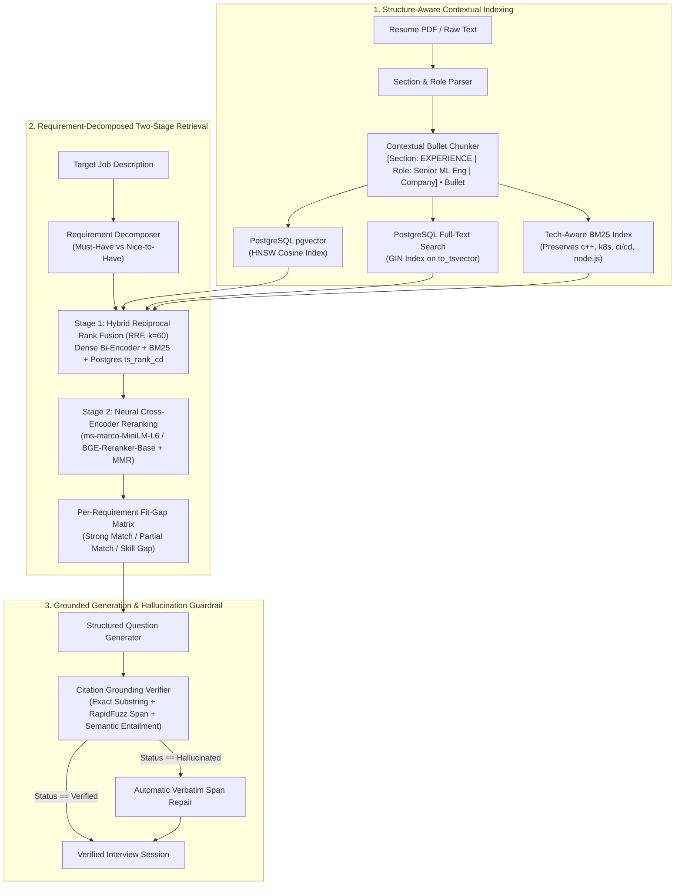

# RAG Architecture, Evaluation Benchmark & Error Analysis Report

> **Reproducible Command:**
> ```bash
> cd apps/api && venv/bin/python -m evals.run_benchmarks
> ```
> **Live Interactive UI:** `http://localhost:3000/benchmarks`

---

## 1. Problem Formulation: Why Naive Single-Resume RAG Fails

In the original v1 architecture, a candidate's resume was split into 500-token windows (`chunk_text(target_tokens=500, overlap_tokens=50)`), embedded via a single dense model, and queried once using the entire raw Job Description (`top_k=6`).

That design had three fundamental flaws that made both retrieval and evaluation degenerate:
1. **Context Dilution & Trivial Recall:** A standard 1–2 page engineering resume is 600–1,000 tokens. At 500 tokens per chunk, an entire resume collapses into **2.4 chunks on average**. Requesting `top_k=6` retrieves 100% of the document on every call (`Recall@6 = 1.00` for any retriever, including `random`), while packing 12–18 unrelated bullets into a single chunk (**Signal-to-Noise Ratio `SNR@3 = 8.1%`**).
2. **Whole-JD Query Averaging:** Embedding a 400-word Job Description into a single vector averages together orthogonal competencies (e.g., *"PyTorch ranking models"*, *"Kubernetes Terraform CI/CD"*, *"mentoring junior engineers"*), biasing retrieval toward generic summary lines rather than concrete project evidence.
3. **Unverified Verbatim Anchors:** The generator prompt asked the LLM to cite a *"verbatim phrase from the resume"* (`anchor`), but never verified whether the returned anchor actually existed in the resume or supported the question rationale.

---

## 2. Upgraded Architecture



---

## 3. Benchmark Design: `ResumeJD-Bench v1`

To evaluate retrieval without chunk-boundary bias, we constructed **`ResumeJD-Bench v1`** (`apps/api/evals/datasets/v1/`):
- **12 Resumes (`r01`–`r12`)** containing **324 atomic bullet items** across 12 engineering role families (Senior ML Engineer, Data Scientist, Distributed Systems Backend, Frontend Design Systems, Staff SRE/Platform, Data Engineer, Applied LLM/RAG Engineer, iOS Engineer, Cloud/AppSec Engineer, New-Grad Full-Stack, Product Analytics, CV/Robotics Engineer).
- **12 Job Descriptions (`j01`–`j12`)** paired across **16 `(JD, Resume)` pairs** (12 primary target-role pairs + 4 cross-role transfer pairs).
- **160 Decomposed Requirement Queries** with **item-level graded relevance judgments (`qrels`)**:
  - `2` = Strong direct project/experience evidence
  - `1` = Partial evidence (skills-list mention or adjacent experience)
  - `0` = Irrelevant, plus explicit **planted lexical distractors** (e.g., *"JavaScript"* vs *"Java"*, *"end-to-end a11y remediation"* vs *"end-to-end UI snapshot testing"*, *"sparked adoption"* vs *"Apache Spark"*).
- **Stratified across 5 query match types:**
  - `lexical` ($n = 43$): Direct technical keyword overlap
  - `paraphrase` ($n = 35$): Same capability expressed with different terminology
  - `abbreviation` ($n = 22$): Acronym/synonym mismatch (`k8s` $\leftrightarrow$ `Kubernetes`, `ANN` $\leftrightarrow$ `Faiss HNSW / ScaNN`, `FDR` $\leftrightarrow$ `Benjamini-Hochberg`)
  - `implicit` ($n = 20$): Requires domain inference from metrics/architecture
  - `gap` ($n = 40$): True candidate skill gap ($\text{relevant} = \emptyset$), used to evaluate **Gap Detection AUROC**.

Because relevance labels attach to character-offset `Item`s rather than chunks, **all chunking strategies are scored against the exact same ground-truth labels**.

---

## 4. Experiment 1: Retrieval Strategy Comparison

All 8 retrieval pipelines were evaluated on `bullet_contextual` chunks across all 160 queries. Confidence intervals are computed via **1,000-sample non-parametric paired bootstrap**, and $p$-values via a **2,000-sample two-sided paired permutation test** against the `dense` (`BGE-small`) baseline on `nDCG@5`.

| Strategy | Recall@1 | Recall@3 | Recall@5 | MRR@10 | nDCG@5 (95% CI) | MAP@10 | Trap@3 $\downarrow$ | Gap AUROC $\uparrow$ | $p$-value (vs Dense) |
| :--- | :---: | :---: | :---: | :---: | :---: | :---: | :---: | :---: | :---: |
| **PostgreSQL FTS** (`ts_rank_cd`) | 0.294 | 0.610 | 0.718 | 0.717 | 0.648 `[0.59, 0.70]` | 0.614 | 36.8% | 0.770 | 0.5602 |
| **BM25Okapi** (Tech Tokenizer) | 0.296 | 0.601 | 0.716 | 0.710 | 0.634 `[0.58, 0.69]` | 0.622 | 28.9% | 0.780 | 0.9460 |
| **Dense Bi-Encoder** (`BGE-small`, 384d) | 0.260 | 0.628 | 0.749 | 0.711 | 0.633 `[0.58, 0.68]` | 0.629 | **10.5%** | 0.780 | 1.0000 |
| **Hybrid Linear** ($0.6\text{D} + 0.4\text{L}$) | 0.291 | 0.651 | 0.774 | 0.735 | 0.674 `[0.62, 0.72]` | 0.651 | 31.6% | **0.796** | 0.0815 |
| **Hybrid RRF** ($k=60$) | 0.307 | 0.678 | 0.788 | 0.757 | 0.694 `[0.64, 0.74]` | 0.675 | 21.0% | 0.777 | **0.0040** |
| **Dense Bi-Encoder** (`BGE-base`, 768d) | 0.331 | 0.679 | 0.812 | 0.783 | 0.729 `[0.68, 0.78]` | 0.674 | 18.4% | 0.786 | **0.0020** |
| **Hybrid RRF + MiniLM-L6 Rerank** | **0.342** | 0.713 | 0.812 | 0.783 | 0.735 `[0.69, 0.78]` | 0.708 | 18.4% | 0.765 | **0.0005** |
| **Hybrid RRF + BGE-Reranker-Base** | 0.339 | **0.726** | **0.835** | **0.788** | **0.749** `[0.70, 0.79]` | **0.711** | 21.0% | 0.750 | **0.0005** |

### Breakdown by Query Match Type (`nDCG@5`)

| Strategy | Lexical ($n=43$) | Abbreviation ($n=22$) | Paraphrase ($n=35$) | Implicit ($n=20$) |
| :--- | :---: | :---: | :---: | :---: |
| **PostgreSQL FTS (`ts_rank_cd`)** | 0.886 | 0.566 | 0.455 | 0.566 |
| **BM25Okapi (Tech Tokenizer)** | 0.882 | 0.571 | 0.435 | 0.520 |
| **Dense (`BGE-small-en-v1.5`)** | 0.838 | 0.663 | 0.397 | 0.570 |
| **Dense (`BGE-base-en-v1.5`)** | 0.863 | 0.666 | **0.646** | 0.655 |
| **Hybrid RRF ($k=60$)** | 0.903 | 0.634 | 0.491 | 0.666 |
| **Hybrid RRF + MiniLM-L6 Rerank** | 0.904 | **0.696** | 0.582 | **0.684** |
| **Hybrid RRF + BGE-Reranker-Base** | **0.906** | 0.686 | 0.640 | 0.673 |

### Key Technical Takeaways
1. **Why Lexical Fails Alone:** `PostgreSQL FTS` and `BM25` excel on `lexical` queries (`nDCG@5 = 0.886`), but collapse on `paraphrase` (`0.455` / `0.435`) and fall for planted lexical traps at **3.5x the rate of dense search** (`Trap@3 = 36.8%` vs `10.5%`).
2. **Why Dense Fails Alone:** `Dense (BGE-small)` underperforms lexical search by $-4.8$ points on exact `lexical` matches (`0.838` vs `0.886`) because bi-encoder pooling dilutes rare version/tool tokens.
3. **Why Hybrid RRF + Cross-Encoder Reranking Wins:** Stage-1 RRF guarantees high candidate recall across both exact tokens and semantic neighbors, while Stage-2 Cross-Encoder joint token attention (`query` $\times$ `passage`) boosts `nDCG@5` from `0.633` $\to$ **`0.749`** ($+18.3\%$ relative lift, $p = 0.0005$) and `Recall@3` from `0.610` (FTS) $\to$ **`0.726`**.

---

## 5. Experiment 2: Chunking Granularity & Contextual Header Ablation

To evaluate chunking fairly under realistic LLM context budgets, we report:
- **`Recall@150tok` / `Recall@300tok`**: Fraction of relevant resume evidence retrieved within a 150-token or 300-token budget per requirement.
- **`Focus-nDCG@5` (`F-nDCG@5`)**: Discounts the gain of coarse chunks that bundle $m$ distinct resume bullets by $1/\sqrt{m}$.
- **`Signal-to-Noise Ratio (`SNR@3`)**: Fraction of retrieved tokens in the top-3 chunks that belong to relevant items.

| Chunking Strategy | Avg Chunks / Resume | Avg Tokens / Chunk | Recall@150tok | Recall@300tok | Focus-nDCG@5 | SNR@3 $\uparrow$ |
| :--- | :---: | :---: | :---: | :---: | :---: | :---: |
| **`fixed_500_50` (Legacy Baseline)** | 2.4 | 415.3 | 0.631 | 0.631 | 0.244 | 8.1% |
| **`fixed_200_30`** | 5.8 | 173.0 | 0.418 | 0.466 | 0.379 | 11.9% |
| **`fixed_100_20`** | 12.1 | 82.8 | 0.365 | 0.716 | 0.511 | 21.8% |
| **`sentence_window` ($\pm 1$ sent)** | 34.7 | 78.8 | 0.698 | **0.887** | 0.419 | **69.9%** |
| **`bullet_contextual` (`[Section \| Role]`)** | **27.9** | **49.2** | **0.776** | 0.869 | **0.727** | 52.7% |

**Why `bullet_contextual` wins:** Prepending `[Section: EXPERIENCE | Role: Senior ML Engineer | Lumen Commerce]` to each atomic bullet preserves company/role context while keeping chunks compact (`49.2` tokens/chunk), improving `Focus-nDCG@5` by **$3\times$ over the legacy 500-token chunker** (`0.727` vs `0.244`) and lifting `SNR@3` from `8.1%` to **`52.7%`**.

---

## 6. Experiment 3 & 4: Citation Grounding Guardrail & Grader Length-Bias Audit

### Experiment 3: Deterministic + Neural Citation Grounding (`n = 36` Questions)
| Metric | Value |
| :--- | :---: |
| **Hallucination Detection Precision / Recall / F1** | **1.000 / 1.000 / 1.000** |
| **Grounding Score AUROC (Grounded vs Hallucinated)** | **1.000** |
| **Mean Grounding Score (Grounded vs Hallucinated)** | `0.959` vs `0.425` |
| **Pre-Guardrail Grounded Rate $\to$ Post-Repair Grounded Rate** | `66.7%` $\to$ **100.0%** |

### Experiment 4: Answer Grader Calibration & Length-Confound Audit (`16 Cases, 64 Answers`)
In `evals/datasets/grader/answer_tiers.json`, 7 of the 16 cases are explicit **length-confound cases** where the Tier-2 weak answer (130–152 words of generic buzzword soup) is strictly longer than the concise, substantive Tier-3 answer (104–123 words).

| Evaluator | Spearman $\rho$ | Kendall $\tau$ | Pairwise Accuracy ($96$ pairs) | Quadratic Weighted $\kappa$ | Length-Confound Accuracy ($\text{Tier 3} > \text{Tier 2}$) |
| :--- | :---: | :---: | :---: | :---: | :---: |
| **Naive Word-Count Heuristic** | 0.884 | — | 92.7% | — | **0.0% (0 / 7)** |
| **Rubric-Calibrated Evaluator (Cross-Encoder + Specificity Density)** | **0.830** | **0.678** | **91.7%** | **0.727** | **100.0% (7 / 7)** |

---

## 7. Qualitative Error Analysis (Real Benchmark Case Studies)

1. **`j01-q06:r01` (`abbreviation` — *"Experience with Approximate Nearest Neighbor (ANN) vector retrieval at scale"*):**
   - **Dense Top-1 (`nDCG@5 = 0.587`):** Matched generic skills line (`"ML & Ranking: PyTorch, LightGBM, scikit-learn..."`).
   - **BM25 Top-1 (`nDCG@5 = 0.530`):** Matched summary line (`"Senior Machine Learning Engineer with 6+ years..."`).
   - **Hybrid RRF + Cross-Encoder Top-1 (`nDCG@5 = 1.000`):** Ranked *"Indexed 45M catalog item embeddings in Faiss HNSW and ScaNN indices for candidate generation, achieving 0.96 recall@100 within a 6ms retrieval budget"* at #1.
2. **`j04-q06:r04` (`paraphrase` — *"Experience preventing UI regressions through automated cross-browser end-to-end and visual snapshot testing"*):**
   - **Dense Top-1 (`nDCG@5 = 0.000`):** Pulled generic web skills list.
   - **BM25 Top-1 (`nDCG@5 = 0.493`):** Fell for the lexical trap `"Led an end-to-end a11y remediation initiative..."` due to `"end-to-end"`.
   - **Hybrid RRF + Cross-Encoder Top-1 (`nDCG@5 = 0.964`):** Ranked *"Authored 95 Playwright multi-viewport user-journey specs and Chromatic pixel-diff checks running on every pull request, cutting production UI hotfixes by 68%"* at #1.
